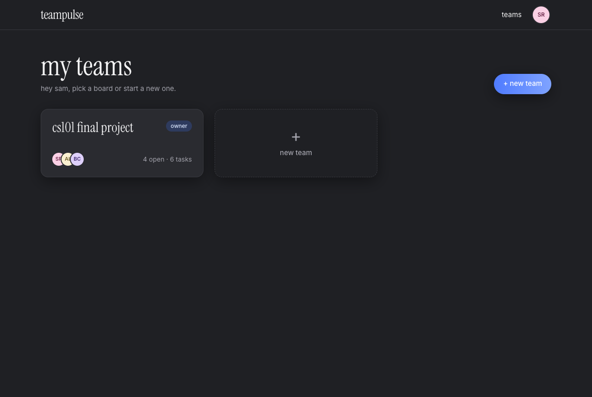
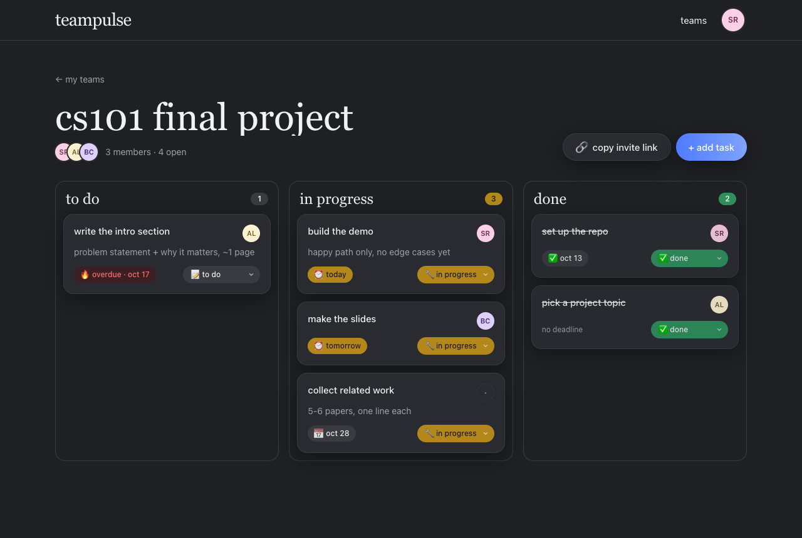
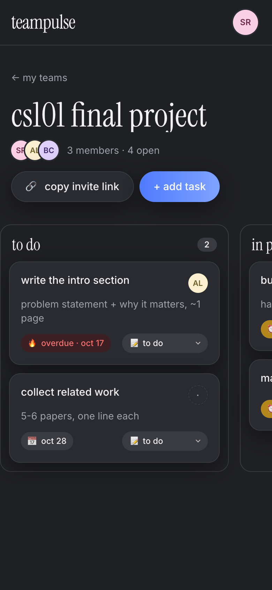
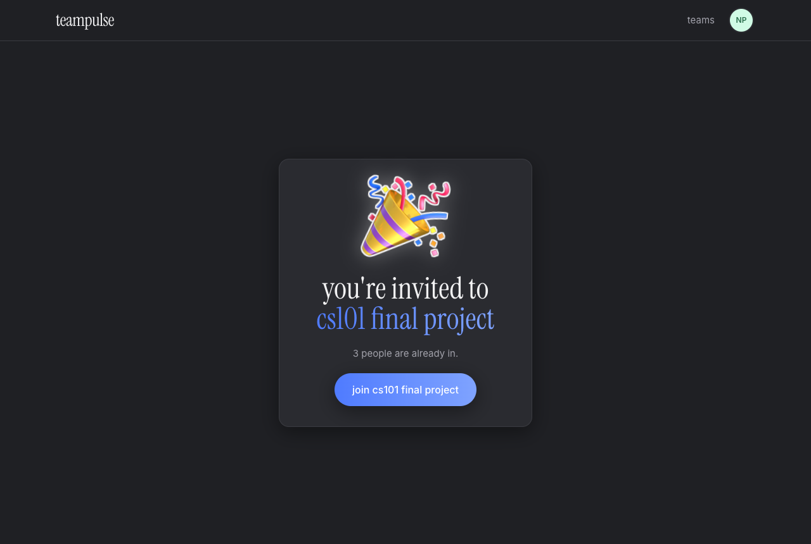

# TeamPulse

A web app for student project teams: one shared board of tasks and deadlines, with each member's contribution visible.

Sprint 1 is complete. This README covers what shipped, how to run it (one Docker command or locally), demo credentials, tests, the API, the design system, and the Sprint 2 backlog.

## Sprint 1: what shipped

| Story | Status | Where |
|-------|--------|-------|
| **US-1** Create a team and invite members by link | ✅ | `/teams`, `/teams/:id` (copy invite link, owner only), `/join/:token` |
| **US-2** Create tasks with deadline and assignee | ✅ | "+ add task" on the board: title, description, date, assignee chips |
| **US-3** Change task status To Do / In Progress / Done | ✅ | drag between columns, or the status select on every card |

Also in Sprint 1, because the stories needed them or the team asked for them:

- Accounts: register, login, JWT sessions, protected routes.
- Deadline chips that turn amber within 24h and red when overdue.
- Task reactions (🔥 ❤️ 💀 😭 👀) on cards, done-task confetti with a hype toast, and an opt-in "vibe mode" that relabels the columns.
- A design system ("playful sticker board, Apple-clean underneath"), dark by default with a light switch, fully responsive, with a live gallery at `/design`.
- Tests: 87 backend tests (pytest, in-memory SQLite) and a Playwright end-to-end run of the whole Sprint 1 scenario.

## Screenshots

More in [`docs/screenshots/`](docs/screenshots/) (light, dark and mobile for every page).

| Landing | Team board |
|---------|------------|
|  |  |

| Board on a phone | Invite landing |
|------------------|----------------|
|  |  |

## Run it

### One command (Docker)

```bash
docker compose up --build
```

Then open http://localhost:5173. The backend API is also exposed directly at http://localhost:8000 (docs at `/docs`).
Data lives in the `teampulse-data` volume, so it survives restarts. `docker compose down -v` wipes it.

Load the demo data (two users, one team, six tasks) into the running stack:

```bash
docker compose run --rm backend python -m scripts.seed_demo
```

### Locally (dev servers)

Backend (Python 3.11+):

```bash
cd backend
python3 -m venv .venv && source .venv/bin/activate
pip install -r requirements.txt
cp .env.example .env            # optional
alembic upgrade head
python -m scripts.seed_demo     # optional: demo data
uvicorn app.main:app --reload   # http://127.0.0.1:8000
```

Frontend (Node 18+), in a second terminal:

```bash
cd frontend
npm install
npm run dev                     # http://localhost:5173, proxies /api -> :8000
```

## Demo credentials

Created by `scripts/seed_demo.py` (safe to re-run; it rebuilds the demo team):

| User | Email | Password | Role in "SE-2405 Demo" |
|------|-------|----------|------------------------|
| Alex Kim | `alex@demo.teampulse` | `demo1234` | owner |
| Maria Lopez | `maria@demo.teampulse` | `demo1234` | member |

The team has six tasks: two done, two in progress, two to do, with deadlines from six days ago to ten days out, assignees spread across both users plus one unassigned, and a few reactions. The script prints the invite link so you can show the join flow in a private window.

Suggested demo script: log in as Alex → open the board → copy the invite link → open it in a private window, register as a third person, join → back as Alex, add a task assigned to Maria → log in as Maria, drag it to in progress, then to done → confetti.

## Stack

- **Backend:** FastAPI, SQLAlchemy 2.x, Alembic, SQLite (dev / demo) or Postgres (production), bcrypt + JWT
- **Frontend:** React 18 + TypeScript, Vite, Tailwind, framer-motion, @hello-pangea/dnd, canvas-confetti
- **Tests:** pytest, Playwright
- Monorepo: `/backend` and `/frontend`, `docker-compose.yml` at the root

## Repository layout

```
backend/
  app/
    main.py          FastAPI app, /health, router registration
    config.py        settings (DATABASE_URL, JWT_*, FRONTEND_URL)
    database.py      engine, session, Base
    models/          SQLAlchemy models
    schemas/         Pydantic request/response models
    core/security.py bcrypt hashing + JWT encode/decode
    api/deps.py      get_current_user / DbSession dependencies
    api/team_access.py  team lookup + membership checks shared by routers
    routers/         API routers (auth, teams, tasks)
  alembic/           migrations
  scripts/seed_demo.py  demo data
  tests/             pytest (in-memory SQLite)
  Dockerfile
frontend/
  src/
    main.tsx, App.tsx   entry, router, auth guards, page transitions
    index.css           design tokens (dark default + light), base styles
    lib/                api.ts (fetch + JWT), auth.tsx, theme.tsx, vibe.tsx, celebrate.ts, motion.ts, dates.ts
    components/ui/      design system: Button, Card, Bubble, Sticker, EmojiBurst, Input,
                        Avatar, StatusPill, Modal (sheet on mobile), Toast, Skeleton, Switch
    components/board/   Board (drag-and-drop), TaskCard, ReactionPicker, DeadlineChip, StatusSelect, AddTaskModal
    components/Nav.tsx
    pages/              Landing, AuthForm (login/register), Teams, TeamPage, Join, Design
  e2e/sprint1.spec.ts Playwright end-to-end scenario
  playwright.config.ts
  Dockerfile, nginx.conf
scripts/e2e.sh         one command: boot backend + frontend, run the e2e
docker-compose.yml
docs/screenshots/      light / dark / mobile captures of every page
```

## Backend details

### Migrations

```bash
cd backend
alembic upgrade head                              # apply all migrations
alembic revision --autogenerate -m "describe it"  # create a new migration after changing models
alembic downgrade -1                              # roll back one step
```

### Tests

```bash
cd backend
pytest
```

Tests run against an in-memory SQLite database and never touch `teampulse.db`. Interactive API docs are at http://127.0.0.1:8000/docs while the server runs.

To run the same suite against Postgres (recommended before a deploy), point `TEST_DATABASE_URL` at an empty database:

```bash
docker run -d --name tp-pg -e POSTGRES_USER=tp -e POSTGRES_PASSWORD=tp -e POSTGRES_DB=teampulse -p 55432:5432 postgres:16-alpine
TEST_DATABASE_URL=postgresql://tp:tp@localhost:55432/teampulse pytest
```

### Configuration

All settings are environment variables (or a local `backend/.env`, see `.env.example`):

| Variable | Default | Notes |
|----------|---------|-------|
| `APP_ENV` | `development` | Anything else (e.g. `production`) makes a missing `SECRET_KEY` a startup error. |
| `DATABASE_URL` | `sqlite:///./teampulse.db` | `postgres://` and `postgresql://` URLs both work; they are normalised to `postgresql+psycopg2://` so the shipped `psycopg2-binary` driver is always used. |
| `SECRET_KEY` | dev-only value | Signs JWTs. `JWT_SECRET` is accepted as a legacy alias. |
| `FRONTEND_URL` | `http://localhost:5173` | Used for invite links and allowed as a CORS origin, alongside `http://localhost:5173`. |
| `ACCESS_TOKEN_EXPIRE_MINUTES` | `1440` | |

### Deploy on Render

`render.yaml` at the repo root is a Render Blueprint for the backend plus a managed Postgres:

- web service `teampulse-backend`, `rootDir: backend`, build `pip install -r requirements.txt`, start `alembic upgrade head && uvicorn app.main:app --host 0.0.0.0 --port $PORT`, health check on `/health`;
- `DATABASE_URL` wired from the `teampulse-db` database, `SECRET_KEY` generated by Render, `APP_ENV=production`;
- `FRONTEND_URL` is left for you to set in the dashboard once the frontend has a URL.

Steps: push to GitHub → Render → *New → Blueprint* → pick the repo → set `FRONTEND_URL` → deploy. Migrations run on every start, so a new release that adds a migration applies it before serving.

The frontend is deployed separately as a static site (`cd frontend && npm run build`, publish `dist/`) with `VITE_API_BASE=https://<backend>.onrender.com` at build time; the API client then calls the backend directly instead of the dev proxy, which is what the CORS allowance is for.

### Auth API

| Method | Path             | Body                      | Response                                    |
|--------|------------------|---------------------------|---------------------------------------------|
| POST   | `/auth/register` | `email, password, name`   | `201` `{access_token, token_type}`; `409` if email taken; `422` on invalid input |
| POST   | `/auth/login`    | `email, password`         | `200` `{access_token, token_type}`; `401` on bad credentials |
| GET    | `/auth/me`       | header `Authorization: Bearer <token>` | `200` user; `401` if missing/invalid/expired |

Passwords are hashed with bcrypt (8–72 chars). Emails are stored lower-cased.
Protected routes take `current_user: CurrentUser` from `app.api.deps`.

### Teams API (US-1)

All routes require `Authorization: Bearer <token>`.

| Method | Path                    | Body     | Response                                                        |
|--------|-------------------------|----------|-----------------------------------------------------------------|
| POST   | `/teams`                | `name`   | `201` team with members; creator is added as `owner`            |
| GET    | `/teams`                |          | `200` list of teams the user belongs to                         |
| GET    | `/teams/{id}`           |          | `200` team + members; `403` if not a member; `404` unknown id   |
| GET    | `/teams/{id}/invite`    |          | `200` `{invite_token, invite_url}`; `403` unless owner          |
| GET    | `/teams/join/{token}`   |          | `200` `{id, name, member_count, already_member}` preview for the join page; `404` unknown token |
| POST   | `/teams/join/{token}`   |          | `200` team + members; idempotent; `404` for an unknown token    |

`invite_url` is `${FRONTEND_URL}/join/{token}`. The token is generated with `secrets.token_urlsafe(32)` and is only exposed to the owner.

### Tasks API (US-2, US-3)

All routes live under `/teams/{team_id}/tasks` and require the caller to be a member of that team (`403` otherwise, `404` for an unknown team or task).

| Method | Path                  | Body / query                                              | Response                                                        |
|--------|-----------------------|-----------------------------------------------------------|-----------------------------------------------------------------|
| POST   | `/`                   | `title` (required), `description?`, `deadline?` (YYYY-MM-DD), `assignee_id?` | `201` task, status `todo`; `400` if assignee is not a team member |
| GET    | `/`                   | `?status=todo\|in_progress\|done`, `?assignee_id=`       | `200` list ordered by creation                                  |
| PATCH  | `/{task_id}`          | any of `title`, `description`, `deadline`, `assignee_id`  | `200` task; only sent fields change, `null` clears; `400` if empty body or bad assignee |
| PATCH  | `/{task_id}/status`   | `{"status": "todo" \| "in_progress" \| "done"}`          | `200` task with bumped `updated_at`; `422` on an unknown status |
| DELETE | `/{task_id}`          |                                                           | `204`; `403` unless caller is the task creator or the team owner |
| POST   | `/{task_id}/reactions` | `{"emoji": "🔥"}`                                        | `200` task; toggles the caller's reaction on/off; `400` for an emoji outside the allowed set |

Every task response carries `reactions`: a list of `{emoji, count, reacted_by_me}` aggregated per emoji, ordered as the allowed set `🔥 ❤️ 💀 😭 👀`. Reacting does not change `updated_at`.

## Frontend details

### Routes

| Path            | Who         | What                                                        |
|-----------------|-------------|-------------------------------------------------------------|
| `/`             | logged out  | landing: hero, floating stickers, three feature cards       |
| `/login`, `/register` | logged out | centered card, inline validation, friendly error bubbles |
| `/teams`        | logged in   | my teams grid, "+ new team" card, create-team modal         |
| `/teams/:id`    | logged in   | team board: header, invite link (owner), kanban, add task   |
| `/join/:token`  | logged in   | invite landing: team preview + join; guests are sent to login and returned here |
| `/design`       | anyone      | storybook-style gallery of every token and component        |

Logged-in users are redirected from `/`, `/login`, `/register` to `/teams`; the reverse redirect sends guests to `/login`.
The JWT lives in `localStorage` under `tp.token`.

### Design system

Direction: "playful sticker board, Apple-clean underneath." See `/design` for the live gallery and `docs/screenshots/` for captures.

- **Theme**: dark is the default. Light applies when the OS prefers light and no choice was stored, or when the user flips the "light mode" switch in the avatar menu (stored as `tp.theme`). An inline script in `index.html` sets `html[data-theme]` before first paint so there is no flash.
- **Tokens** are CSS variables on `:root` in `src/index.css` (dark values) with the light set under `:root[data-theme="light"]`, exposed to Tailwind as `bg-bg`, `bg-surface`, `bg-surface-2`, `border-line`, `text-ink`, `text-muted`, `bg-accent`, `bg-bubble` / `text-bubble-ink`, `bg-todo`, `bg-progress`, `bg-done` and their `-ink` text pairs. On dark, shadows are subtle and 1px borders carry separation; stickers get a soft white glow.
- **Type**: Instrument Serif for display (always lowercase), Inter for body. Loaded from Google Fonts in `index.html`.
- **Spacing**: 8pt grid, 44px minimum tap targets, `rounded-2xl` cards with a 1px border and `shadow-soft`.
- **Motion** (`src/lib/motion.ts`): cards lift 4px on hover with a spring, buttons scale 0.97 on press, pages fade and slide 8px. `<EmojiBurst emojis={[…]}>` wraps any element and floats 5–9 emojis up on hover or focus; `useEmojiBurst(emojis, { big: true, manual: true })` gives an imperative `burst()` for submit moments (16–21 emojis). Dropped cards settle with an overshoot curve. Everything respects `prefers-reduced-motion` via framer-motion's `MotionConfig reducedMotion="user"` plus explicit gates in the burst hook and the drop animation.

### Board

- Three columns (to do / in progress / done) with count badges in the status colours. On phones the columns scroll horizontally with snap points.
- Drag a card between columns (`@hello-pangea/dnd`) to change its status. The UI updates immediately, then calls `PATCH /status`; on failure the card goes back and a toast explains. Each card also has a status select for keyboard and touch.
- Deadline chips: red tint when overdue, amber when due today or tomorrow, neutral otherwise, and neutral again once the task is done.
- "Add task" is a modal on desktop and a bottom sheet on mobile, with an avatar chip picker for the assignee. Submitting fires a big 🚀 burst from the header button.
- Loading states are skeletons shaped like the real layout, never spinners.

### Fun bits on the board

- **Reactions**: hover a card (desktop) or long-press it (touch) for a floating pill with 🔥 ❤️ 💀 😭 👀. Picking one toggles it through `POST …/reactions` optimistically and fires a mini burst of that emoji. Existing reactions show as small chips in the card footer, highlighted when yours; tapping a chip toggles it too. Because long-press is the touch gesture, card dragging is disabled on coarse pointers and the status select does the job there.
- **Done celebration**: moving a task to done (drag or select) fires `canvas-confetti` from the card and a toast with a random line from twenty in `src/lib/celebrate.ts`. The toast auto-dismisses after 2.5s. Under `prefers-reduced-motion` only the toast shows.
- **Vibe mode**: a switch in the board header, stored per user as `tp.vibe.<userId>`, off by default. On, the columns read "not my problem yet / locked in / ate" and an overdue chip becomes 🫠 with the tooltip "it's giving procrastination".

## Database schema

| Table          | Columns                                                                                                          |
|----------------|------------------------------------------------------------------------------------------------------------------|
| `users`        | id, email (unique), password_hash, name, created_at                                                              |
| `teams`        | id, name, invite_token (unique), owner_id → users, created_at                                                    |
| `team_members` | team_id → teams, user_id → users, role (`owner` \| `member`), joined_at; unique (team_id, user_id)               |
| `tasks`        | id, team_id → teams, title, description?, deadline (date)?, assignee_id? → users, status (`todo` \| `in_progress` \| `done`), created_by → users, created_at, updated_at |
| `task_reactions` | id, task_id → tasks, user_id → users, emoji, created_at; unique (task_id, user_id, emoji)                       |

## Known limitations / Sprint 2 backlog

Next up, in priority order:

1. **US-4 Contribution statistics**: per-member counts of created / assigned / completed tasks, on-time rate, and a small per-team summary on the board header. The data is already there (`created_by`, `assignee_id`, `status`, `deadline`, `updated_at`); this needs an aggregate endpoint and a stats panel.
2. **US-5 Reminders**: notify assignees about deadlines due tomorrow and overdue tasks. Needs a scheduler (or a cron hitting an endpoint), user notification preferences, and a delivery channel (email first).

Known limitations in Sprint 1:

- Tasks can be created and moved, but not edited or deleted from the UI. The backend supports both (`PATCH` / `DELETE`), the screens are not built.
- No way to leave a team, remove a member, or rotate an invite link. Anyone with the link can join.
- Cards inside a column are ordered by creation time; dragging within a column does not reorder.
- Touch devices use the status select instead of drag-and-drop (long-press is reserved for reactions).
- The teams page makes two extra requests per team for members and task counts; fine for a handful of teams, worth a summary endpoint later.
- Deadlines are dates, not times, and "within 24h" means today or tomorrow in the browser's local time.
- SQLite locally, Postgres in production (`render.yaml`). The schema avoids native enums so both work from the same migrations; the test suite passes on both.
- JWTs expire after 24h with no refresh and no logout-everywhere; passwords are capped at 72 characters (bcrypt).
- No email verification, password reset, or rate limiting.
